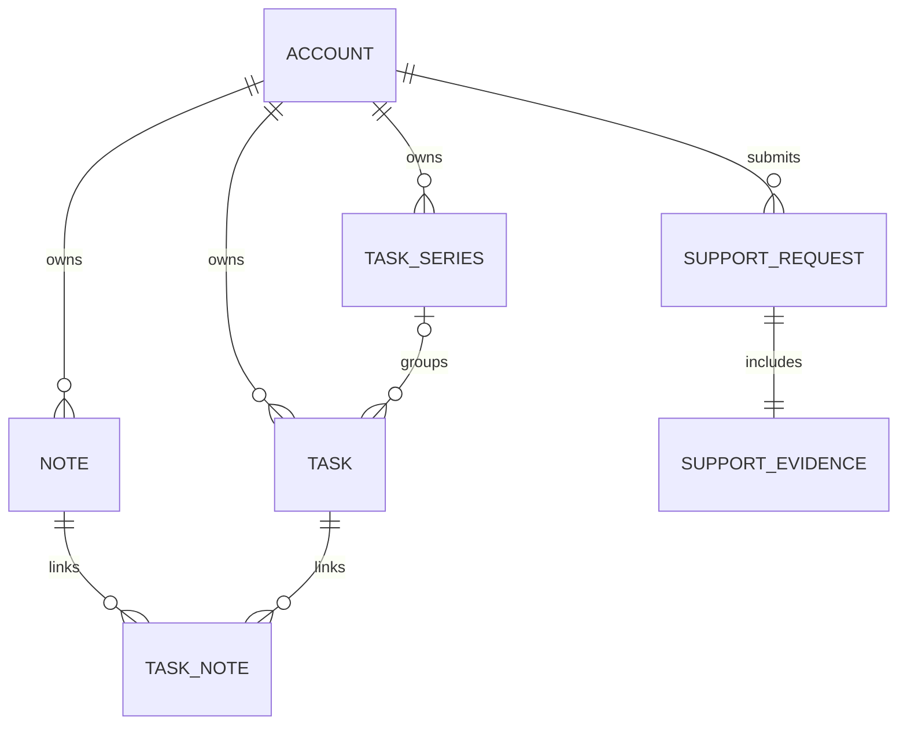

# Phase 2 — Data model and scheduling

**Status: Phase 2 baseline.** [REQUIREMENTS.md](../REQUIREMENTS.md) records the confirmed behavior. The user approved the week boundary, reopening and date-editing rules below.

## Proposed PostgreSQL schema

| Table | Core fields and constraints |
| --- | --- |
| `accounts` | Primary key `id`, unique normalized `email`, `password_hash`, `role` (ADMIN or USER), nullable `activated_at` and `locked_at`, and `session_generation` for revocation. Account verification and lock transitions are specified with authentication. |
| `notes` | Primary key `id`, `owner_id` referencing account, `title`, `body`, editable `starts_at` and system-managed `updated_at` as `timestamptz`. |
| `task_series` | Primary key `id`, `owner_id` referencing account, `series_month` as a `date` holding the first day of the Vietnam calendar month. |
| `tasks` | Primary key `id`, `owner_id` referencing account, optional `series_id`, `title`, `scheduled_date` as `date`, `start_time` and `end_time` as local `time`, `progress` and nullable `completed_at` as `timestamptz`. Deadline derives from `scheduled_date`. Require start and end and check `start_time < end_time`, with both times strictly before 24:00. |
| `task_notes` | Unique pair of task and note IDs with `owner_id`. Composite foreign keys from this row to `(owner_id, id)` on both parents enforce shared ownership. Deleting either parent deletes its link rows only. |
| `support_requests` | Primary key `id`, requester account reference, type, request text, processing status and submission time. Requester verification and workflow states are specified with support. |
| `support_evidence` | Unique request reference, unique Cloudinary asset ID, public ID and verified HTTPS image URL. The request and evidence commit together. |
| `evidence_upload_intents` | ID, requester account, purpose, assigned Cloudinary public ID, expiry and consumption state. Bind an unlock upload to the verified unlock flow. Use these records to verify submissions and clean up abandoned assets. |
| `notification_jobs` | Unique event identifier, notification type, account or request reference, processing state, attempt count and next attempt time. Record support notification jobs in the same transaction as the decision. Store any activation delivery secret separately from ordinary event data and apply the activation TTL. See [authentication and support](auth-and-support.md). |

Declare unique parent keys on `(owner_id, id)` where needed for composite references, including the series reference from a task. Check ownership on every operation in NestJS as well. Make `(series_id, scheduled_date)` unique for series occurrences. Standalone tasks on the same date may overlap. Propose indexes by account and date for task lookups and by account and update time for note lists. Choose additional indexes after the query shapes are specified. See [PostgreSQL constraints](https://www.postgresql.org/docs/current/ddl-constraints.html) and [date/time types](https://www.postgresql.org/docs/current/datatype-datetime.html).

## Scheduling rules

- Interpret dates, week membership and task times in `Asia/Ho_Chi_Minh`. Timetable weeks run Monday through Sunday. Query a week as seven Vietnam dates starting on Monday, including for weeks spanning two months. A series action applies only to occurrences in the selected task's series.
- A standalone task creates one row. A recurring task creates a series and one row for the start date and each date seven days apart while still in that month. Create all rows in one transaction. Each occurrence starts at `TODO` and has an independent completion time.
- Model progress as `TODO`, `IN_PROGRESS` and `DONE`. Users can reopen completed work. Transitioning to `DONE` saves the current completion instant. Saving `DONE` again retains that instant. Reopening clears it. A progress update applies to one occurrence.
- Compute labels in this order: completed, overdue, before scheduled start, then stored progress. For completion, late days are the positive difference between Vietnam completion date and scheduled date. An unfinished task becomes overdue at the next Vietnam midnight. The frontend renders backend labels and refreshes around the next relevant boundary.
- Apply ordinary field and time edits to all selected occurrences. For a date change, calculate each target from the same day offset. Set any target after the series month to the last day of that month in Vietnam time. The deadline follows the resulting scheduled date. Reject the whole batch if a target is before the series month or if the resulting date duplicates another occurrence of the same series. Resolve membership from the displayed week and selected occurrence IDs and recheck ownership and membership within the transaction.
- Bulk deletes affect only the chosen monthly series. The preserve-week option excludes the week open in the timetable, including when the displayed week spans two months. Validate the selection first. If an edit or delete cannot be applied in full, roll back the operation.

## Acceptance scenarios to carry into Phase 3

| Scenario | Expected outcome | Baseline |
| --- | --- | --- |
| Start at 23:00 and end the next day | Rejected. Another task with an overlapping same-day slot is valid. | AC-10 |
| Complete before start, or one Vietnam day after the scheduled date | Early completion shows done. Late completion shows one day late. | AC-01, AC-02 |
| Start a weekly series on 26 November | Only the 26 November occurrence exists. December requires a separate series. | AC-03, AC-05 |
| A December occurrence scheduled on Monday 28 December is moved to Saturday 2 January | The occurrence is scheduled and due on Thursday 31 December, using the selected same-day time slot. | User-approved month-end rule, AC-09 |
| A date shift would place two occurrences of the same series on the last day of the month, or move one into the previous month | Reject the entire edit and preserve all existing occurrences. | User-approved scheduling rule, AC-09 |
| Delete all except the displayed week | Keeps that week's occurrences in the selected series. Other series are untouched. | AC-08, AC-09 |
| Link a note to a task belonging to another owner | Rejected. Deleting an owned task with valid links preserves the notes. | AC-04, AC-11 |
| Retry or race a bulk edit/delete with an overlapping selection | The design must serialize conflicting changes or return a conflict and avoid partial updates. Define exact conflict responses in the API contract. | AC-08, AC-09 |
